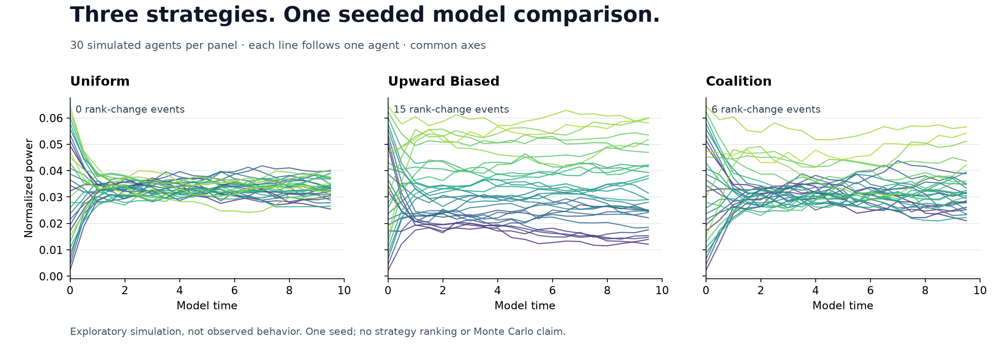

# Macaque Social Dynamics

**Explore how grooming assumptions change simulated power and rank dynamics.**

A Python simulator for alliances, continuous power updates, and discrete rank changes. This six-person team project combines biological initialization with stochastic numerical simulation. My work focused on configuration, grooming matrices, and matrilineal rank initialization.

[Run the demo](#run-it) · [My contribution](#my-contribution) · [Validation](docs/VALIDATION.md)

## See the model run



**Read the figure:** each line follows one simulated agent. All panels use the same axes, seed 42, and 30 agents. In this short run, rank-change event counts were **0 / 15 / 6** for uniform / upward-biased / coalition grooming. These counts describe one model run; they do not rank the strategies' biological effectiveness.

| What you can explore | Verified output |
|---|---|
| Switch between three grooming strategies | Three runs with 20 logged states each, through model time 9.5 |
| Follow power and rank dynamics | 1,800 agent-state values exported; finite normalized power at every logged step |
| Inspect the underlying model | Original team suite: **281 tests passed** on Python 3.12 |

[Trajectory CSV](docs/demo/power-trajectories.csv) · [Run settings and counts](docs/demo/run-summary.json) · [Figure generator](examples/plot_strategy_results.py)

<details>
<summary><strong>Inspect the grooming assumptions</strong></summary>


Rows are groomers; columns are recipients. These are model inputs, not measured behavior. Matrices use a common color scale and are generated by [the contribution demo](examples/contribution_demo.py).

</details>

## Run it

Python 3.10+ is declared; Python **3.12** was tested. From the repository root:

```bash
python3 -m venv .venv
source .venv/bin/activate
# Windows PowerShell: .venv\Scripts\Activate.ps1
python -m pip install -e ".[dev,studies]"
python examples/contribution_demo.py
python examples/plot_strategy_results.py
python -m pytest -q
```

The first demo writes input matrices and a summary to `output/contribution-demo/`; the second writes the result plot, trajectory CSV, and run settings to `output/strategy-results/`. Both directories are ignored by Git. Matplotlib renders the new result plot without Chrome or Kaleido.

For a configuration-file run:

```bash
python -m macaque_sim.main --config examples/quickstart.json
```

The logger records the 10-unit example through time **9.5**; the visualization preserves this behavior. [Tested dependencies](constraints-tested.txt) record the core verification environment; the new plot was rendered with Matplotlib 3.11.2. [Validation details](docs/VALIDATION.md) separate execution checks from scientific validity.

## My contribution

I led the **configuration and biology layer**, supported by the original division-of-labor statement. The complete team simulator is retained so these modules run in context.

| Area | Implementation |
|---|---|
| Configuration | [Typed parameters, validation, file overrides, and random seeds](macaque_sim/config/sim_config.py) |
| Grooming strategies | [Uniform, upward-biased, and coalition matrices](macaque_sim/config/scenarios.py) |
| Biological initialization | [Matrilines, inherited ranks, normalized power, and initial alliances](macaque_sim/initializer/mri_init.py) |
| Interpretation | [Biological rationale and contribution evidence](docs/CONTRIBUTIONS.md) |

The team implemented the numerical solvers, event system, experiment workflows, and visualization components. Shared files and the original role record are documented in [contribution notes](docs/CONTRIBUTIONS.md). The short public demos and reproducible figure are later additions.

## Model workflow

**Configure → initialize alliances/power/ranks → update continuous dynamics → apply rank-change events → inspect trajectories.**

`macaque_sim/config` and `initializer` define inputs; `solvers` and `events` advance the model; `experiments`, `analysis`, and `visualization` support longer studies. Original robustness runners remain in `scripts/`.

## Interpretation and source

This is an exploratory model. Strategy comparisons depend on timestep, hysteresis, and cooldown settings; some original production cells did not converge under timestep refinement. The original report also found similar alpha-survival outcomes under MRI and random rank initialization for the metric examined. Neither this initializer nor the short demo establishes a causal biological effect.

The archive lacks the Monte Carlo result JSONs used by the original report. This edition therefore does not claim to reproduce those headline findings. [Source and file selection](docs/PROVENANCE.md) · [Original source manifest](docs/source-manifest.json).

The original [MIT license](LICENSE) is preserved. The archived [AI use statement](AI_USAGE.md) is a **team-level record without individual attribution**; it does not establish personal AI use by Anna Cho.
