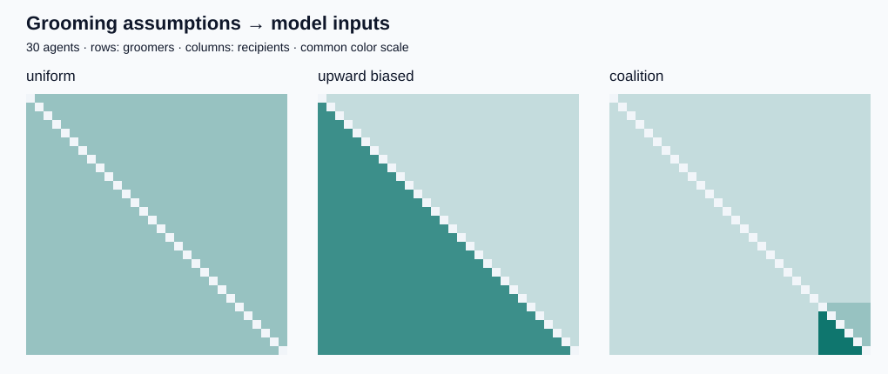

# Macaque Social Dynamics Simulator

**Explore how grooming strategies, alliance dynamics, and conflict rules shape a simulated dominance hierarchy.**

A team-developed Python simulator combining stochastic alliances, continuous power updates and discrete rank changes. This portfolio highlights Anna Cho's configuration, grooming-matrix and biological initialization contributions. It is an exploratory model, not a validated predictor of real macaque behavior.

## Features and verified demo

- Compare **uniform, upward-biased and coalition** grooming assumptions.
- Initialize matrilines, ranks, power and alliances with reproducible seeds.
- Run simulations and inspect power histories, rank-change events and strategy matrices.



**What the figure shows:** model input assumptions, not measured behavior or a survival-rate comparison. Rows are groomers and columns are recipients; panels share one color scale.

| Verification | Observed result |
| --- | --- |
| Original team regression suite | 281 tests passed locally on Python 3.12 |
| Contribution demo | All three strategies passed initialization and finite normalized-power checks |
| Quick-start simulation | Completed with 20 logged steps and 6 events; final logged time 9.5 |

These checks verify execution, not scientific validity or reproduction of the original Monte Carlo findings. [Validation details](docs/VALIDATION.md).

## Quick start

Python **3.10+** is declared; the locally verified environment is **Python 3.12**. Run these commands from the repository root:

```bash
python3 -m venv .venv
source .venv/bin/activate
# Windows PowerShell: .venv\Scripts\Activate.ps1
python -m pip install -e ".[dev]"
python examples/contribution_demo.py
python -m macaque_sim.main --config examples/quickstart.json
python -m pytest
```

The demo writes to `output/contribution-demo/` (ignored by Git). For the exact dependency versions used in the local verification, install with:

```bash
python -m pip install -c constraints-tested.txt -e ".[dev]"
```

To focus on the configuration and initialization layer:

```bash
python -m pytest macaque_sim/tests/test_config.py macaque_sim/tests/test_grooming_matrix.py macaque_sim/tests/test_mri_init.py macaque_sim/tests/test_mri_init2.py macaque_sim/tests/test_init.py
```

[Validation record](docs/VALIDATION.md) distinguishes fresh local checks from historical test counts. The [GitHub Actions workflow](https://github.com/hayannacho/macaque-social-dynamics/actions) provides hosted test runs; see the workflow results for the current status.

## How the simulator fits together

1. **Configure and initialize:** choose a grooming matrix and construct initial alliances, power, and ranks — the layer I led.
2. **Advance continuous dynamics:** the team's Euler–Maruyama solver updates alliances; the RK4 solver updates power.
3. **Apply discrete events:** hysteresis and cooldown rules govern rank changes.
4. **Run experiments and inspect results:** Monte Carlo runners, perturbations, and Plotly visualizations support analysis.

```text
macaque_sim/
  config/          Parameters, grooming strategies, shared scenario definitions
  initializer/     Matrilineal rank inheritance and initial state
  solvers/         Team numerical integrators
  events/          Rank changes, cooldown, logging
  experiments/     Monte Carlo runs and perturbations
  analysis/        Sensitivity and stability utilities
  visualization/   Team Plotly figures and animations
  tests/           Original team regression suite
examples/          Short contribution demo and JSON configuration
scripts/           Original robustness-study runners
```

## My contribution — Anna Cho

I led the **configuration and biology layer**, translating biological assumptions into configurable, testable initial conditions. The original team's division-of-labor statement supports the scope below; this repository preserves the complete team simulator so that my modules can be run in context.

| Area I led | Implementation | What to look for |
| --- | --- | --- |
| Model configuration | [`SimConfig`, `default_config`, `load_config`](macaque_sim/config/sim_config.py) | Typed parameters, validation, JSON/YAML overrides, reproducible random seeds |
| Grooming strategies | [`uniform_grooming`, `upward_biased_grooming`, `coalition_grooming`, `build_grooming_matrix`](macaque_sim/config/scenarios.py) | Three explicit social-interaction assumptions represented as matrices |
| Matrilineal rank inheritance (MRI) initialization | [`mri_init.py`](macaque_sim/initializer/mri_init.py) | Matriline construction, initial ranks, normalized power, and alliance seeding |
| Biological interpretation | [Contribution notes](docs/CONTRIBUTIONS.md) and [original biological background](docs/source/biological_background.original.md) | Literature-based interpretation and justification of tuned defaults, with model limitations kept explicit |

**Shared-file boundary:** `scenarios.py` also contains Jenny's experiment schema and scenario factories. My contribution is the grooming-matrix portion; I do not claim sole authorship of that file, the numerical solvers, or the full simulator. The tests linked below exercise my contribution areas; they are retained team tests, not a claim that I authored each test.

[Original division of labor](docs/source/team-contributions.txt) · [Team credits and evidence](docs/CONTRIBUTIONS.md)

## Scope and limitations

- **Calibration matters.** The original report found that strategy comparisons depend on hysteresis thresholds, cooldown duration, and time discretization. Some production cells were not converged under timestep refinement. Do not present historical headline percentages as calibration-independent facts.
- **Biological framing is an assumption, not proof.** The report found similar alpha-survival outcomes under MRI and random rank initialization for the metric examined. My initializer makes the assumptions explicit; its existence does not establish a causal biological effect.
- **This is a runnable source edition, not a complete archival reproduction.** The supplied snapshot lacks the `output/results/` Monte Carlo JSONs referenced by the original report/notebook. Large embedded-output notebooks, incomplete report-build assets, presentations, and administrative coursework files are omitted. See [provenance and file selection](docs/PROVENANCE.md).
- Original robustness scripts remain available for longer runs. They are not part of the quick-start validation, and their output should be interpreted with the same limitations. Install `python -m pip install -e ".[studies,images]"` for the optional plotting stack and run the study scripts from the root with `PYTHONPATH=.`. Figure export additionally needs Kaleido and a compatible Chrome installation; the quick start avoids that dependency.

## Team and license

This is a **six-person team project**. Samantha led the SDE/multirate side; Benyuan the ODE/RK4 side; Anna the configuration/biology layer; Aaryan discrete events; Jenny the experiment pipeline; and Parisa visualization. See [full credit boundaries](docs/CONTRIBUTIONS.md).

The original [MIT license](LICENSE), including its copyright notice, is preserved unchanged. Original source records are retained with source hashes in [the manifest](docs/source-manifest.json). No original Git history was supplied for this snapshot, so this edition does not reconstruct commit authorship or imply that its packaging date is the original development date.

The archived [AI use statement](AI_USAGE.md) is a **team-level record** without individual user attribution; it does not establish personal AI use by Anna Cho.
